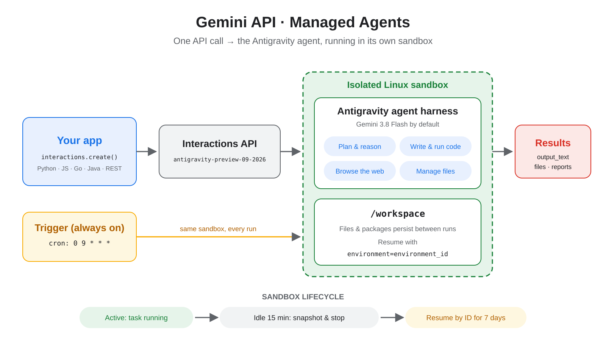

# gemini-agy-examples

Examples and verification suites for **Google Gemini API Managed Agents** running the Google Antigravity agent harness (`antigravity-preview-09-2026`).



## Overview

| Script | Description |
| :--- | :--- |
| [`run_and_resume.py`](run_and_resume.py) | Streams a live agent interaction in an isolated remote Linux sandbox (`environment="remote"`), resumes in the same sandbox via `environment_id`, verifies file persistence, and exports the generated `analysis.html` dashboard locally before deleting the sandbox. |
| [`schedule_trigger.py`](schedule_trigger.py) | Creates an always-on cron trigger (`triggers.create`) with domain allowlisting and optional credential injection, verifies its active status via `triggers.get`, and cleans up automatically. |
| [`interactive_cli.py`](interactive_cli.py) | Full interactive local REPL for chatting with a remote Antigravity agent in real time, with live SSE streaming, tab-completed slash commands (`/new`, `/fork`, `/ls`, `/upload`, `/download`, `/model`, `/argon`, `/clear`, `/reset`, `/envs`, `/attach`, `/detach`), and automatic sandbox lifecycle management. |

## Prerequisites

- **Python ≥ 3.10** and [**uv**](https://docs.astral.sh/uv/) (`brew install uv`)
- `GEMINI_API_KEY` set in your environment (recommended via macOS Keychain):

```bash
# Store key in macOS Keychain
security add-generic-password -U -a "$USER" -s GEMINI_API_KEY -w

# Load in ~/.zshrc
export GEMINI_API_KEY="$(security find-generic-password -a "$USER" -s GEMINI_API_KEY -w 2>/dev/null)"
```

## Setup

```bash
uv sync --frozen
```

## Usage

### 1. Run & Resume in a Stateful Remote Sandbox (`run_and_resume.py`)

```bash
# Default run (uses gemini-3.8-flash)
uv run python run_and_resume.py

# Run with Gemini 4 Argon
uv run python run_and_resume.py --argon

# Specify any supported model and custom output path
uv run python run_and_resume.py --model gemini-4-argon --output dashboard.html

# Preserve the remote sandbox after completion instead of deleting it
uv run python run_and_resume.py --keep-env
```

### 2. Scheduled Cron Trigger (`schedule_trigger.py`)

```bash
# Test full trigger creation, verification, and cleanup without requiring a pre-registered secret
uv run python schedule_trigger.py --no-credential

# Configure the scheduled trigger to use Gemini 4 Argon
uv run python schedule_trigger.py --no-credential --argon

# Run with the default 'github-production' stored credential
uv run python schedule_trigger.py

# Leave the trigger active on the schedule (default: 09:00 America/New_York)
uv run python schedule_trigger.py --no-credential --keep
```

### 3. Interactive Remote Agent CLI (`interactive_cli.py`)

```bash
# Launch interactive session (provisions a remote Linux sandbox on your first prompt)
uv run python interactive_cli.py

# Launch interactive session powered by Gemini 4 Argon
uv run python interactive_cli.py --argon

# Attach to an existing remote sandbox ID
uv run python interactive_cli.py --env-id <ENVIRONMENT_ID>

# Built-in REPL Slash Commands:
#   /new | /fork                Provision a fresh sandbox or clone the current one
#   /ls [path]                  List files in the remote sandbox (auto-provisions if needed)
#   /upload <local> [remote]    Upload a local file into the sandbox (auto-provisions if needed)
#   /download <remote> [local]  Download a file from the sandbox to local disk
#   /model <name> | /argon      Switch the underlying model on the fly
#   /clear                      Clear conversation history while keeping sandbox files
#   /reset                      Delete current sandbox and provision a fresh one
#   /envs | /attach | /detach   List, attach to, or detach from remote sandboxes
#   /status | /help | /quit     Inspect session status, help, or exit cleanly
```
